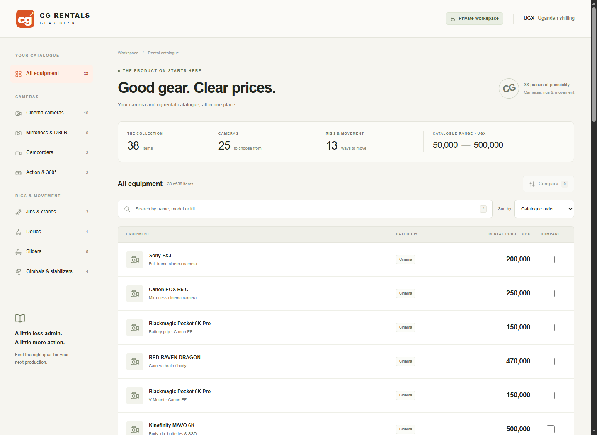

# CG Rentals · Gear Desk

[](https://www.yotip.me/twistkan)

Private, buildless rental catalogue with 38 equipment entries. Open `dist/index.html` through an HTTP server; the app fetches `catalogue.json` from the same origin.

## Screenshot



## Source

`catalogue.csv` preserves the names, prices and categories from `Cams_and_Rigs_Pricelist_with_Categories.csv`, saved on 7 September 2026. The source does not specify a rental period. Prices are displayed as catalogue prices without adding a daily rate, taxes, availability or booking claims.

`scripts/prepare-data.py` converts this CSV into `dist/catalogue.json`, adding concise display names, brief package descriptions and eight filter groups. Original names and categories remain in each JSON record. Comparison displays the original catalogue entry alongside the concise description.

## Prepare and validate

```sh
python3 scripts/prepare-data.py
node --check dist/app.js
```

Browser QA completed on desktop and within 390 px and 320 px phone viewports: catalogue count, search, combined category/search filtering, price sorting, empty results/reset, comparison selection, distinct package variants, UGX differences, four-item limit, selection persistence, native dialog dismissal, and horizontal overflow.

Selection is saved only in the current browser's local storage. No external assets, analytics or API services are used. Sites hosting provides private owner access; the in-page label and robots metadata are informational, not access controls. Preserve owner-only access for future deployments unless the user approves a change.
